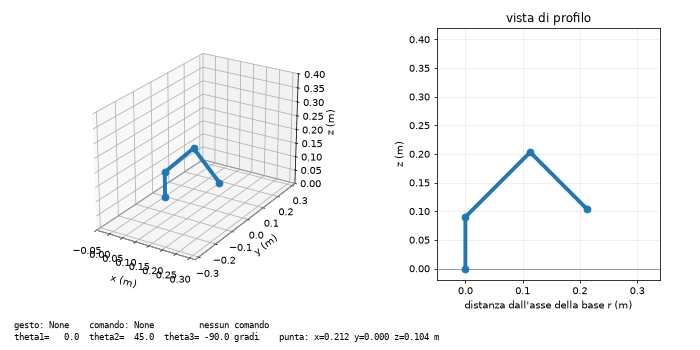

# Gesture-Controlled Robotic Arm with CUDA-Accelerated Perception

A hand-gesture recognition pipeline whose image preprocessing runs on **CUDA kernels written from scratch**, driving a simulated **3-DOF robotic arm** whose **inverse kinematics is computed live** rather than replayed from stored poses. Recognised gestures move the end effector (up / down / left / right, plus stop). ROS2 + Gazebo, and a 6-DOF version with a spherical wrist, are the planned next stages.

The project ties together three areas that are usually studied separately: systems programming in C++/CUDA, machine learning, and robotics (kinematics, ROS2).



*A recorded video of hand gestures drives the simulated arm. The trail is the path of the tip; when a command would take the tip outside the reachable workspace, the arm stays where it is.*

## Status

| Part | State |
|---|---|
| CUDA preprocessing (resize, normalization, HWC→CHW) | Done, verified against torchvision, benchmarked |
| Python ↔ CUDA binding (`ctypes`) | Done |
| Gesture classifier (19 classes, MobileNetV2 fine-tuned) | Done — 94.9 % validation accuracy; 5 gestures enabled for control |
| Fixed central ROI crop before the classifier | Done (basic: the hand must be inside the box) |
| Temporal gesture filter (majority vote over a window) | Done |
| Video demo (file source, annotated output) | Done; live webcam not tested (WSL2 does not see it) |
| 3-DOF RRR arm: analytic forward/inverse kinematics, joint limits, tests | Done |
| Gesture → command → arm control loop, matplotlib simulation | Done (offline, driven by a recorded video) |
| Real hand detector (hand anywhere in the frame) | Not started (see [Limitations](#limitations)) |
| Arm CAD model, URDF, ROS2 nodes, Docker, Gazebo | Not started |
| 6-DOF version with spherical wrist | Planned (stage 2) |

Detailed phases are in [`docs/scaletta-progetto-ros2-cuda-ml.md`](docs/scaletta-progetto-ros2-cuda-ml.md) (in Italian); the arm design notes are in [`docs/braccio-rrr.md`](docs/braccio-rrr.md) (in Italian).

## How it works

```
camera frame or video (H×W×3, uint8, RGB)        camera.py
      │
      ▼
fixed central ROI crop (60 % of the short side)  roi.py
      │
      ▼
CUDA pipeline (cuda/cuda_wrappers.cu)
  1. resize to 224×224 by area averaging  (one thread per output pixel)
  2. ImageNet mean/std normalization       (per-channel, float32)
  3. HWC → CHW layout conversion
      │
      ▼
MobileNetV2 classifier (PyTorch), 19 classes
      │
      ▼
temporal filter (majority vote over 7 frames)    gesture_filter.py
      │      stable gesture, or None = "no command"
      ▼
gesture_to_command   like / fist / peace / rock / palm → direction;
      │              any other gesture, or None → no command
      ▼
apply_command        target = tip position + direction × STEP
      │
      ▼
inverse kinematics   (θ1, θ2, θ3), or None if the target is unreachable → the arm stays still
      │
      ▼
arm drawn in 3D and in side view (matplotlib)    [planned] URDF + Gazebo + ROS2
```

The CUDA library is compiled to a shared object and called from Python through `ctypes`; `python/src/cuda_preprocess.py` validates the input (dtype, shape, contiguity) before handing raw pointers to the GPU.

## Results

### Classifier

- **Dataset:** the public HaGRID classification set (512 px, hand crops): all 18 gesture classes plus `no_gesture` (capped at 7000 images), 19 classes in total, 80/20 train/validation split with a fixed seed.
- **Model:** MobileNetV2 pretrained on ImageNet (transfer learning), a new 19-class output layer, last feature blocks fine-tuned with a lower learning rate than the head, 5 epochs (about 17 minutes per epoch on the GPU below).
- **History:** the first version used only 5 classes (`fist`, `like`, `palm`, `peace`, `rock`): 74 % with only the output layer trainable (underfitting) → 97.3 % after partial fine-tuning. The model was then retrained on all 19 classes so it can serve as a backbone if more gestures are enabled later; only the 5 gestures above drive the arm, everything else is ignored (no command).
- **Validation accuracy (19 classes): 94.9 %.** This is not comparable with the 97.3 % of the 5-class model: it is a 19-way problem.
- **Per class:** best `mute` 99.4 %, `no_gesture` 98.4 %, `call` and `dislike` 98.0 %; weakest `three` 86.3 %, `peace` 89.7 %, `four` 90.5 %.
- **Main confusions:** `four` ↔ `three`, `three` ↔ `peace`, `call` ↔ `like`, `palm` ↔ `stop`, `peace_inverted` ↔ `two_up_inverted`, `one` ↔ `two_up`. Similar gestures should not be enabled together; the 5 gestures used for control avoid these pairs, and a misread such as `palm` → `stop` falls on the safe side (an unmapped gesture means no command).
- Informal check on 10 of my own photos (5 gestures, 2 each, not published): with the 19-class model the crop gets 10/10 and the full frame 8/10, the errors being exactly the confusable pairs above (`like`→`call`, `palm`→`stop`). Too small to be a measurement.

### CUDA preprocessing vs. the torchvision training pipeline

The classifier was trained with torchvision (`Resize` bilinear with antialias, `ToTensor`, `Normalize`). Replacing it with the CUDA pipeline, on 500 random validation images (measured on the 5-class model, not repeated for the 19-class one):

| | torchvision | CUDA |
|---|---|---|
| Validation accuracy (500 images) | 97.6 % | 97.4 % |
| Same predicted class | 495 / 500 (99 %) | |

The difference is one image out of 500, within noise. The remaining disagreements come from the resize: the CUDA kernel averages the source block of each output pixel (box filter), while torchvision uses a triangular filter. A first version of the kernel used nearest-neighbour sampling; its mean pixel error against the training pipeline was about nine times larger on a test image, which is why it was replaced.

Reproduce with `python3 compare_batch.py` (from `python/src`).

### Benchmark

Preprocessing time per frame, starting from a NumPy RGB array. CPU = PIL + torchvision (the training transform). CUDA time includes the per-call allocation, host↔device copies and kernels. Median of 200 runs after warm-up, three separate runs; synthetic random images; **NVIDIA GeForce RTX 5050 Laptop GPU**.

| Input size | CPU (ms) | CUDA (ms) | Speedup |
|---|---|---|---|
| 512×512 | 1.1 – 1.3 | 0.9 – 1.0 | 1.0× – 1.3× |
| 640×480 | 1.4 – 1.6 | 0.8 – 0.9 | 1.5× – 1.9× |
| 1920×1080 | 5.1 – 5.5 | 1.3 – 1.4 | 3.8× – 4.2× |

A MobileNetV2 forward pass on one image takes about **2.7 ms** on the same GPU. At 640×480 the preprocessing therefore saves roughly 0.6 ms per frame out of ~4 ms; at 1920×1080 the CPU preprocessing alone would be the bottleneck. CUDA time barely grows with resolution, which suggests it is dominated by fixed per-call costs (not profiled yet).

Reproduce with `python3 benchmark.py`.

### Fixed ROI crop

HaGRID classification images are tight hand crops, so a full frame with a small hand is out of distribution. As a first, deliberately simple step, `roi.py` crops a fixed central square (60 % of the shorter side) and the user holds the hand inside it. On my 10 own photos the crop was right every time (10/10) while the full frame was not (8/10 with the 19-class model, 9/10 with the earlier 5-class one); the crop fraction was stable between about 50 % and 80 %. The real fix is a hand detector (see below).

### Video demo and temporal filter

`camera.py` yields RGB frames from a video file or a webcam index (OpenCV, BGR→RGB at capture, frames streamed through a generator). `live_demo.py` runs crop → CUDA preprocessing → classifier → filter on each frame and writes an annotated video with the ROI box, the raw prediction and the stable gesture. Per-frame processing (crop + preprocessing + classification) took **4.2–4.8 ms**, excluding video decoding, drawing and encoding.

Raw per-frame predictions flicker, especially while the hand moves between gestures. `GestureFilter` keeps a sliding window of the last 7 predictions (low-confidence ones, below 0.7, count as "none") and outputs a gesture only if at least 80 % of the window agrees; otherwise it outputs `None`, meaning "no command". Transitions therefore produce `None` instead of a wrong gesture, which is what keeps the arm from jittering. The price is latency of about window / fps (7 frames ≈ 0.23 s at 30 fps). Parameters were tuned by eye on a single short recorded video, and the behaviour was unchanged when the model went from 5 to 19 classes.

```bash
python3 live_demo.py ../../data/videos/gesti1.mp4   # annotated video (from python/src)
python3 live_demo.py 0                              # webcam index (not tested)
```

### Arm: kinematics

The arm is a **3-DOF RRR**: the base rotates about the vertical axis (θ1), shoulder and elbow (θ2, θ3) rotate about parallel horizontal axes. It is stage 1; a spherical wrist (6 DOF) is stage 2. Design notes: [`docs/braccio-rrr.md`](docs/braccio-rrr.md).

| Parameter | Value |
|---|---|
| Shoulder height above the table, H | 0.09 m |
| Upper arm L1 / forearm L2 | 0.16 m / 0.14 m |
| θ1 (base) | −90° … +90° |
| θ2 (shoulder, from the horizontal) | 0° … 90° |
| θ3 (elbow, relative to the upper arm) | −150° … −5° (negative: elbow up) |
| Minimum tip height | 0.01 m above the table |

Forward kinematics (the side view works in the plane of the arm, `r` is the horizontal distance of the tip from the base axis):

```
r = L1·cos θ2 + L2·cos(θ2+θ3)        x = r·cos θ1
z = H + L1·sin θ2 + L2·sin(θ2+θ3)    y = r·sin θ1
```

Inverse kinematics (closed form, no iteration):

```
θ1 = atan2(y, x)
r  = √(x²+y²),  zz = z − H
D  = cos θ3 = (r² + zz² − L1² − L2²) / (2·L1·L2)      |D| > 1 → unreachable → None
θ3 = −acos(D)                                          (the elbow-up solution)
θ2 = atan2(zz, r) + atan2(L2·|sin θ3|, L1 + L2·cos θ3)
```

The result is rejected (`None`) if any joint is outside its limits or the tip would be below the minimum height. The Jacobian determinant of the planar part is `L1·L2·sin θ3`, so the arm is singular when fully stretched (θ3 = 0); the limit at −5° keeps a margin from it. All geometry and limits live in one file, `python/arm/arm_config.py`.

**Tests** (`python/arm/test_kinematics.py`): 3 configurations with known results; 878 random configurations within the joint limits go angles → tip → angles and come back to the same angles within 1e-6 (0 failures; 122 more were skipped because the tip falls below the table, and the inverse correctly rejects them); 4 unreachable points (too far, on the base axis, behind the base, below the table) are rejected.

### Arm: control and simulation

| Stable gesture | Command |
|---|---|
| `like` | up |
| `fist` | down |
| `peace` | left |
| `rock` | right |
| `palm` | stop |

Any other gesture, or no stable gesture, means no command. Each command moves the target tip position by a fixed step (`STEP`, 1 cm); inverse kinematics turns the target into joint angles, and if the target is unreachable the arm simply stays where it was. `simulate.py` draws the arm in 3D and in side view, with the joint angles and the state of each command.

```bash
# from python/control
python3 demo_arm.py ../../data/videos/gesti1.mp4          # video → gestures → arm, saves demo_arm.gif
python3 simulate.py --gif out.gif                          # scripted sequence of gestures, no video
```

## Limitations

- **Hand must be in the ROI.** The crop is a fixed central box, not a detector: a hand outside it is not seen. A hand detector (a lightweight pretrained one, or my own) is the planned replacement. Full frames without cropping are less reliable, especially on the confusable pairs (for example `like` read as `call`).
- **The arm is only simulated, and offline.** The demo processes a recorded video and then animates the result; there is no real-time loop yet, and no CAD model, URDF, ROS2 nodes or Gazebo.
- **Live webcam not tested.** WSL2 does not expose the webcam; development used recorded video. Options: USB passthrough, or streaming frames from Windows.
- **Arm speed depends on the command rate.** A command is applied every 3rd frame (about 10 steps per second at 30 fps, 10 cm/s with a 1 cm step); in a real-time loop the step or the rate would need tuning.
- **Only 5 of the 19 classes are used for control**, and the gesture set was chosen from validation statistics, not from user studies.
- **Filter parameters** come from one video and have not been validated on more data.
- **Resize is not bit-identical** to torchvision's antialiased bilinear (see above); accuracy impact on the validation set is within noise, but not zero.
- **Fixed per-call overhead.** `process_image` allocates and frees GPU buffers on every call. Persistent buffers, pinned host memory and fewer synchronizations are obvious next optimizations; the gain would show mostly at low resolutions.
- Input must be RGB. OpenCV frames (BGR) have to be converted before calling the pipeline.

## Repository layout

```
cuda/                   CUDA kernels and C wrapper (cuda_wrappers.cu), standalone test (resize_kernel.cu)
python/src/             perception
  config.py             single source of truth: paths, classes, image size, ImageNet statistics
  dataset.py            ImageFolder, augmentation, train/validation split
  model.py              build_model(): MobileNetV2 with a 19-class head
  train.py              fine-tuning loop with best-checkpoint saving
  evaluate.py           confusion matrix, per-class accuracy
  inference.py          load model, predict from a preprocessed tensor
  cuda_preprocess.py    Python binding to the CUDA pipeline
  compare_preprocessing.py   single-image comparison CUDA vs torchvision
  compare_batch.py      same comparison over many validation images
  benchmark.py          CPU vs CUDA timing
  roi.py                fixed central ROI crop
  camera.py             frame source (video file or webcam), yields RGB
  gesture_filter.py     temporal filter: stable gesture over a sliding window
  demo_image.py         classify one image, full frame vs ROI crop
  demo_folder.py        same over a folder of labelled photos
  live_demo.py          video demo: crop → CUDA → classifier → filter, annotated output
python/arm/             robotic arm
  arm_config.py         single source of truth: geometry, joint limits, margins, step
  kinematics.py         forward_kinematics, inverse_kinematics, within_limits
  test_kinematics.py    known cases, random round trip, unreachable points
  viz.py                joint positions for drawing
python/control/         from gestures to arm motion
  gesture_to_command.py gesture → direction, direction → new tip position
  simulate.py           animation of the arm (3D + side view)
  demo_arm.py           video → stable gestures → arm animation
python/scripts/         dataset download
docs/                   roadmap, arm design notes (braccio-rrr.md), images
```

## Running it

Requirements: Python 3, PyTorch + torchvision, NumPy, Pillow, matplotlib, OpenCV, `huggingface_hub` (dataset download only), an NVIDIA GPU with the CUDA toolkit (`nvcc`).

```bash
# 1. Build the CUDA library
cd cuda
nvcc -shared -Xcompiler -fPIC cuda_wrappers.cu -o cuda_wrappers.so
cd ..

# 2. Dataset: downloads the HaGRID classification archive from Hugging Face (several GB),
#    extracts the 19 classes listed in python/src/config.py (no_gesture capped) under
#    data/hagrid/hagrid-classification-512p-no-gesture-150k/<class>/
pip install huggingface_hub
python3 python/scripts/download_dataset.py

# 3. Train / evaluate (from python/src)
cd python/src
python3 train.py          # note: overwrites the checkpoint in models/
python3 evaluate.py

# 4. Predict on one image, compare pipelines, benchmark
python3 inference.py path/to/image.jpg
python3 compare_batch.py
python3 benchmark.py

# 5. Video demo (writes an annotated video to data/videos/out.mp4)
python3 live_demo.py path/to/video.mp4

# 6. Arm: kinematics tests, then the full demo (from python/arm and python/control)
cd ../arm && python3 test_kinematics.py
cd ../control && python3 demo_arm.py path/to/video.mp4
```

## Planned work

1. Arm CAD model, URDF with the dimensions already in `arm_config.py`, and a Docker image with ROS2 Jazzy and Gazebo; ROS2 nodes for camera, inference and arm control.
2. Stage 2: 6-DOF arm with a spherical wrist (position/orientation decoupling for the analytic inverse kinematics).
3. Real-time loop with a webcam, and a hand detector to replace the fixed ROI; validation of the temporal filter on more video.
4. Version 2: a Reinforcement Learning component for the arm (to be defined), planned to coincide with a Reinforcement Learning course. Possible hardware: a 3D-printed arm driven by an Arduino (servos powered externally, common ground).

## Scope note

The CUDA kernels, the Python binding, the training/inference code, the kinematics (derived by hand and written by me, with tests) and the gesture-to-arm control are written by me; the visualization script was prepared with the help of an AI assistant. The classifier backbone is a pretrained MobileNetV2 (transfer learning) and the data is the public HaGRID dataset.
