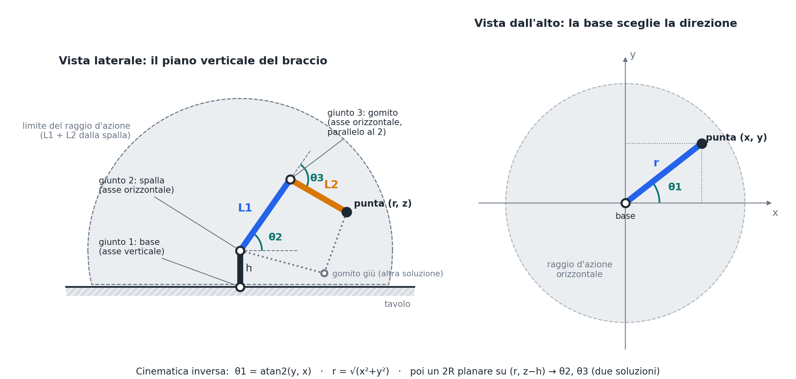
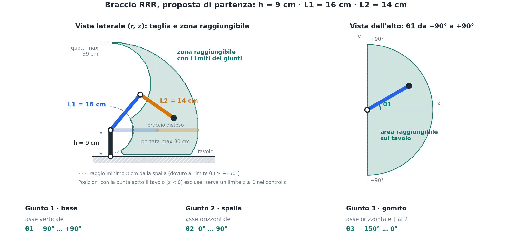
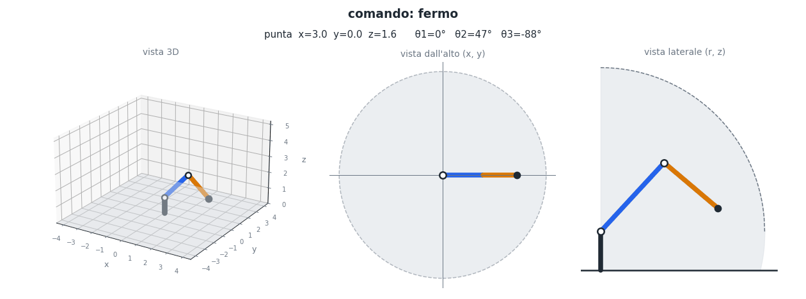

# Braccio RRR a 3 gradi di libertà — scheda di progetto

Stato: **proposta di partenza (16/10/2026)**. I valori numerici non sono ancora confermati:
vedi "Decisioni aperte". Questa scheda raccoglie in un posto solo geometria, formule, limiti,
interfaccia con il resto del progetto e prossimi passi.



## 1. Idea in una riga

Prima tappa del braccio: **3 giunti rotoidali** (base verticale + spalla + gomito) che
posizionano la punta in 3D con comandi cartesiani (destra, sinistra, su, giù, avanti,
indietro). Più avanti si aggiunge il polso sferico (altri 3 giunti) e diventa il braccio a
6 DOF della roadmap: la parte di posizione scritta qui resta valida.

Scartati: 2R planare (copre solo un piano) e pan–tilt a 2 giunti (la punta sta su una sfera:
non si possono eseguire spostamenti cartesiani esatti, e la cinematica inversa è banale).

## 2. Geometria

| Elemento | Descrizione | Valore proposto |
|---|---|---|
| Giunto 1 · base | asse verticale, ruota l'intero braccio | θ1 ∈ [−90°, +90°] |
| `h` | altezza della spalla dal tavolo | 9 cm |
| Giunto 2 · spalla | asse orizzontale | θ2 ∈ [0°, 90°] (da orizzontale verso l'alto) |
| `L1` | spalla → gomito | 16 cm |
| Giunto 3 · gomito | asse orizzontale, parallelo al 2 | θ3 ∈ [−150°, 0°] (relativo a L1) |
| `L2` | gomito → punta | 14 cm |

Convenzioni usate nelle formule: piano verticale del braccio con coordinate `(r, z)`,
`r = √(x²+y²)`, origine alla base sul tavolo; la spalla è in `(0, h)`.



Conseguenze dei valori proposti (calcolate campionando i limiti, non a occhio):

- portata orizzontale massima **30 cm** (`L1 + L2`), quota massima **39 cm**;
- **raggio minimo 8 cm** dalla spalla: il limite θ3 ≥ −150° impedisce al gomito di
  chiudersi del tutto;
- con θ2 ≤ 90° la punta sta sempre davanti alla base (`r ≥ 0`), quindi θ1 = atan2(y, x)
  basta a scegliere la direzione;
- **circa il 9% delle combinazioni di angoli porta la punta sotto il tavolo** (z < 0; il
  minimo è −5 cm, per esempio θ2 = 0°, θ3 = −90°): serve un limite `z ≥ 0` nel controllo,
  meglio con un piccolo margine (1–2 cm);
- θ3 non cambia mai segno: esiste una sola delle due soluzioni (gomito su), niente scelta
  da fare tra soluzioni.

## 3. Cinematica diretta (da scrivere)

Dagli angoli alla punta, nel piano verticale e poi ruotata di θ1:

```
r = L1·cos(θ2) + L2·cos(θ2 + θ3)
z = h + L1·sin(θ2) + L2·sin(θ2 + θ3)
x = r·cos(θ1)        y = r·sin(θ1)
```

Prove di verifica a mano: tutti gli angoli a zero → punta in `(L1+L2, 0, h)`; θ2 = 90°,
θ3 = 0° → punta in `(0, 0, h + L1 + L2)`.

## 4. Cinematica inversa (da scrivere tu)

Prova a derivarla prima di guardare. Dettagli nascosti qui sotto.

<details>
<summary>Traccia della soluzione</summary>

1. Base: `θ1 = atan2(y, x)`.
2. Riduzione al piano: `r = √(x²+y²)`, `zz = z − h`.
3. Gomito, legge dei coseni:
   `D = (r² + zz² − L1² − L2²) / (2·L1·L2)`, `θ3 = −acos(D)` (gomito su).
   Se `|D| > 1` il punto è **irraggiungibile** (fuori dall'anello tra |L1−L2| e L1+L2).
4. Spalla: `θ2 = atan2(zz, r) − atan2(L2·sin θ3, L1 + L2·cos θ3)`.
5. Controllare i limiti dei giunti e `z ≥ 0` (punta **e** gomito): se violati, risultato
   "non valido", il braccio non si muove.

Trappole: usare `atan2`, non `atan`; limitare `D` a [−1, 1] solo dopo aver deciso
l'irraggiungibilità; gradi e radianti.
</details>

**Test obbligatorio:** il giro completo `punta → IK → FK → punta` deve restituire la punta di
partenza (errore ~1e-9) su tanti punti casuali raggiungibili.

## 5. Interfaccia con il resto del progetto

```
gesto stabile (GestureFilter: gesto o None)
      │   gesto → comando  (mappatura in configurazione)
      ▼
delta cartesiano (dx, dy, dz)  ──►  nuova punta = punta + delta
      │
      ▼
solve_ik(x, y, z) -> (θ1, θ2, θ3)  oppure  None (irraggiungibile / fuori limiti / z<0)
      │
      ▼
braccio (simulazione o servo); se None: nessun movimento
```

Se questa firma resta uguale, il modulo IK a 3 giunti si può sostituire con quello a 6 DOF
senza toccare il resto.

Mappatura gesti → comandi, da decidere (il modello a 19 classi permette sei direzioni +
fermo). Evitare di mettere sui versi opposti due gesti che il classificatore confonde
(peace/rock, palm/stop): si sceglie guardando la matrice di confusione.

## 6. Un solo file di configurazione

`h`, `L1`, `L2`, limiti dei giunti, passo dei movimenti, margine sul tavolo: tutto in un
file (`arm_config.py`, come `config.py`). Nessun numero scritto dentro le formule: così
cambiare servo o misure è una riga.

## 7. Verso la stampa 3D

- **Coppia sulla spalla.** Stima grossolana a braccio orizzontale, con masse *ipotizzate*
  (link1 30 g, servo del gomito 55 g, link2 30 g, punta 10 g): circa **2,1 kg·cm**. Con
  margine 2–3× servono servo da 5–6 kg·cm o più. SG90 (~1,8) e MG90S (~2,2) non bastano;
  un MG996R (~10) sì, ma è più pesante. Da rifare con i componenti reali.
- I limiti scelti (≤ 180°) sono compatibili con servo hobby: angolo del modello = angolo
  del servo.
- Link da 14–16 cm entrano in qualunque stampante.
- Precisione: gioco di 1–2° dei servo economici ≈ 5 mm sulla punta a 30 cm.
- Elettronica: Arduino UNO R4 Minima, 3 servo su pin PWM, **alimentazione esterna 5–6 V con
  almeno 2–3 A e massa in comune**; mai dal pin 5 V della scheda.
- SolidWorks → URDF: l'add-in "SolidWorks to URDF Exporter" genera URDF e mesh STL; il
  pacchetto è in stile ROS 1, va adattato a ROS2 Jazzy (ament, launch Python, tag
  `ros2_control` e plugin Gazebo a mano). Verificare scala (mm/m) in RViz. Controllare la
  documentazione aggiornata prima di affidarsi a questi passaggi.
- Disegnare il CAD **dopo** aver fissato i parametri: gli assi del polso/gomito devono
  coincidere con la geometria usata per la cinematica.

## 8. Animazione di riferimento



Sequenza destra → su → indietro → sinistra → giù → avanti con IK a ogni passo: l'ultimo
comando porta al bordo del raggio d'azione e il braccio si ferma.

## 9. Piano di lavoro del braccio

- [ ] Fissare `h`, `L1`, `L2`, limiti, margine sul tavolo (`arm_config.py`)
- [ ] Cinematica diretta + prove a mano
- [ ] Cinematica inversa + test del giro completo su punti casuali
- [ ] Prove di movimento (matplotlib): sequenze di delta, limiti, singolarità, z ≥ 0
- [ ] Mappatura gesti → comandi (dopo la matrice di confusione del modello a 19 classi)
- [ ] Modulo di controllo (`gesture_to_command`) provato su video
- [ ] URDF a 3 giunti, RViz, poi Gazebo con `ros2_control`
- [ ] Nodo camera → nodo inferenza → nodo controllo (ROS2 Jazzy, Docker)
- [ ] Aggiornare README e roadmap quando i parametri sono confermati

## 10. Decisioni aperte

1. Valori definitivi di `h`, `L1`, `L2` (e `L1 = L2` o no).
2. Limiti dei giunti: θ2 fino a 90° o oltre; θ1 ±90° o giro completo.
3. Comando continuo (finché il gesto resta) o a passo singolo.
4. Mappatura dei gesti, dopo i risultati del modello a 19 classi.
5. Servo e stampante (solo per la fase fisica).
